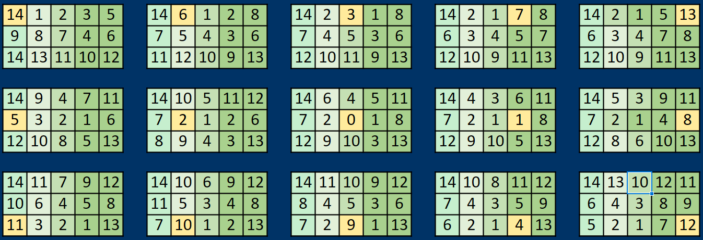

# Каждому по свой идеальный раскладке

## Вступление

Известно, что [QWERTY](https://layouts.wiki/layouts/legacy/qwerty/) была придумана для механических печатных машинок и решала конкретную проблему того времени: а именно - предотвращение заедания соседних клавиш при быстром наборе текста.
Машинок давно нет, а раскладка осталась.
Неоптимальный, устаревший реликт прошлого, решающий более несущественную проблему.

Люди давно пытаются уйти от QWERTY создавая новые более совершенные раскладки:

*   [Dvorak](https://layouts.wiki/layouts/legacy/dvorak/),
*   [Colemak](https://layouts.wiki/layouts/2000s/colemak/),
*   [Workman](https://layouts.wiki/layouts/2010s/workman/).

И каждая из них может претендовать на звание именно той идеальной раскладки, которая должна заменить QWERTY.
Но проблема тут в том, что принципиально невозможно создать такую раскладку, которая была бы идеальна для всех,
так как у каждого свои представления о том, что удобно, а что нет.

Кому-то может нравится постоянное переключение между руками. Тогда ему подойдет [CT-GAP](https://layouts.wiki/layouts/2022/ctgap/):

```
qplcj xfou_
rntsg yheia
zbmwv kd___
```

А кто-то считает что важно максимизировать [inward rolls](TBD), тогда ему нужно использовать [Xpert](https://layouts.wiki/layouts/2000s/xpert/):

```
xprty kuioj
qsdfn hael_
zwcvb gm___
```

Возникает вопрос: зачем пытаться сделать очередную идеальную раскладку имени себя?
Раскладка, хорошая для всех, не может быть идеальной ни для кого.

А что если дать людям возможность создать ту самую раскладку, которая идеально подходит именно им?

Слышали про эффект ИКЕА? Люди ценят вещи больше, если сами участвовали в их создании.
Вам будет нравиться то, что вы выбрали сами, а не то, что за вас решил кто-то другой.

Этот проект как раз про это. Вы задаете метрики и предпочтения, а система помогает собрать раскладку, которая максимально им соответствует.

Хотите сразу попробовать? Можно взять мои настройки и готовые данные и запустить поиск раскладки. Команда запуска и инструкции - в [README](../readme.md).

Чтобы настроить результат под себя, начните с разделов про [метрики](#5-%D0%BC%D0%B5%D1%82%D1%80%D0%B8%D0%BA%D0%B8) и [ограничения размещения](#6-%D0%BE%D0%B3%D1%80%D0%B0%D0%BD%D0%B8%D1%87%D0%B5%D0%BD%D0%B8%D1%8F-%D1%80%D0%B0%D0%B7%D0%BC%D0%B5%D1%89%D0%B5%D0%BD%D0%B8%D1%8F). Готовые оценки удобства основаны на моих ощущениях и моей клавиатуре.

## Как всё началось

Пару лет назад я уже исследовал этот [вопрос](https://medium.com/@sgaliamov/evaluating-keyboard-layouts-for-ergodox-ez-cf70042c4865).

Одной из главных причин тогда, почему я ввязался в это, было то, что я хотел уменьшить нагрузку на мизинцы.
Я стал ощущать физический дискомфорт и даже боль на подушечках мизинцев при длительном наборе текста.
Мизинец самый слабый палец и кажется просто неразумно нагружать его так же как и указательный или средний.

Но тогда я остановился на том, что идеальной раскладки не существует.
Что лучшее, что вы практически можете сделать - это просто выбрать эргономичную клавиатуру и выбрать любую мейнстримную раскладку кроме кверти и дворак (например, [Colemak](/tbd) или [Workman](/tbd)).
И возможно, все это действительно не имеет смысла так как One of the [fastest typists](https://monkeytype.com/profile/rocket) use qwerty after all.

Но не это было главной причиной остановки.
Меняя язык, я сталкивался с тем, что смещались не только привычные шорткаты (например, `Ctrl+C`, `Ctrl+V`), но и все буквы на клавиатуре.
Раскладка на другом языке была бы не просто не оптимальной, а совершенно рандомной.
На тот момент я пользовался эргодокс. Пожалуй, одной из лучших клавиатур на рынке.
Решить это возможно было с отдельными слоями - нужно было иметь слой с раскладкой и слой с кверти.
Но практически это не было удобно - приходилось нажимать много кнопок для переключения между слоями - сначала сменить слой, затем сменить язык в операционной системе.
Мы же стремимся к эргономике и удобству использования клавиатуры. Так?
Все это было жутко неудобным, и я оставил кверти.

Но это не давало мне покоя и переодически продолжал думать об этом,
и настал момент, когда я таки решился создать собственную клавиатуру.
Не просто раскладку, а именно полностью DIY клавиатуру.

Эргодокс меня тоже не устраивал своей громоздкостью и отсутствием функционального ряда.
Мне, как программисту, этот ряд нужен. Конечно, можно использовать вим команды, но не всегда это удобно.

Вооружившись FreeCAD, 3D принтером, видяшками из ютуба, QMK, паяльником и терпением, я приступил к проектированию.
(добавить скриншот из FreeCAD)
В итоге получилось это (картинку вставить здесь, и ссылку на проект). Да не идеал. Да есть куда расти. Да - откровенно уродливо.
Но это позволяло обойти первоначальные блокеры.
Позднее я опишу как я обходил эти проблемы в разделе про трюки с QMK (ссылка на раздел).

Имея на руках семи-идеальную клавиатуру я решил, что для идеальной клавиатуры нужна идеальная раскладка.

\[TODO: скриншот из FreeCAD, фото клавиатуры, ссылка на проект клавиатуры.\]https://github.com/sgaliamov/evo-board

## Основная идея

### Биграммы

Чтобы сравнивать раскладки, каждой нужна численная оценка. Одной частоты букв и усилия отдельных клавиш недостаточно: удобные по отдельности клавиши могут образовать неудобный переход. Поэтому я оцениваю пары последовательных букв (биграммы): оценка пары зависит от расположения обеих клавиш и удобства перехода между ними. При переходе между руками я учитываю только усилие нажатия второй клавиши, так как вторая рука не зависит от первой.

Дальше цепочка рассуждений простая: чем чаще встречается биграмма, тем больший вклад её стоимость вносит в оценку слова. Складывая вклады всех биграмм, получаем оценку слова, а складывая оценки слов - оценку корпуса на конкретной раскладке.

У первой буквы слова нет предыдущей клавиши, а значит, нет и биграммы. Поэтому её частоту и усилие нажатия я учитываю отдельно. Так биграммы вместе с первыми буквами дают оценку усилия для всего корпуса, и раскладки можно сравнивать между собой.

Также учитываются триграммы (последовательности из трёх букв), но я использую их только для отдельного небольшого SFS-штрафа: палец может не успеть переместиться к третьей клавише, особенно при смене ряда.

Подробности расчета: [модель оценки](evaluation/scoring.md) и [штрафы за отклонения от метрик](evaluation/penalty.md).

### Генетический алгоритм

У оценки через биграммы есть ещё одно важное преимущество. Нам не нужно заново прогонять весь корпус через каждую раскладку. Достаточно один раз посчитать частоты сочетаний и первых букв слов, а дальше умножать их на стоимость соответствующих нажатий и переходов. Вместо гигабайтов текста мы работаем с небольшой таблицей частот.

Это позволяет генерировать и сравнивать тысячи раскладок за приемлемое время. Но для полного перебора вариантов всё равно слишком много. Можно было бы искать случайно, каждый раз создавая независимую раскладку, но мне хотелось не просто перебирать варианты, а постепенно улучшать найденные.

Для этого я выбрал генетический алгоритм. У меня уже была рабочая, проверенная реализация, поэтому казалось логичным использовать её и здесь: создаю набор раскладок, оцениваю, отбираю лучшие, изменяю и повторяю.

Для этого нужны статистика корпуса, оценки удобства клавиш и переходов, метрики и ограничения. Дальше разберём, как всё это подготовить и запустить поиск.

## Путь от текста до раскладки

1.  Подготовка статистики
    *   [Корпус: `merge`](#%D0%BA%D0%BE%D1%80%D0%BF%D1%83%D1%81-merge)
    *   [Статистика: `stats` и `frequencies`](#%D1%81%D1%82%D0%B0%D1%82%D0%B8%D1%81%D1%82%D0%B8%D0%BA%D0%B0-stats-%D0%B8-frequencies)
2.  Ранжирование усилий
    *   [Эргономика: `rank`](#3-%D1%8D%D1%80%D0%B3%D0%BE%D0%BD%D0%BE%D0%BC%D0%B8%D0%BA%D0%B0-rank)
    *   [Линейка: `evaluate` и известные раскладки](#4-%D0%BB%D0%B8%D0%BD%D0%B5%D0%B9%D0%BA%D0%B0-evaluate-%D0%B8-%D0%B8%D0%B7%D0%B2%D0%B5%D1%81%D1%82%D0%BD%D1%8B%D0%B5-%D1%80%D0%B0%D1%81%D0%BA%D0%BB%D0%B0%D0%B4%D0%BA%D0%B8)
3.  Определение метрик и ограничений
    *   [Метрики](#5-%D0%BC%D0%B5%D1%82%D1%80%D0%B8%D0%BA%D0%B8)
    *   [Ограничения размещения](#6-%D0%BE%D0%B3%D1%80%D0%B0%D0%BD%D0%B8%D1%87%D0%B5%D0%BD%D0%B8%D1%8F-%D1%80%D0%B0%D0%B7%D0%BC%D0%B5%D1%89%D0%B5%D0%BD%D0%B8%D1%8F)
4.  Генетический алгоритм для поиска раскладки
    *   [Поиск раскладки: `optimize`](#7-%D0%BF%D0%BE%D0%B8%D1%81%D0%BA-%D1%80%D0%B0%D1%81%D0%BA%D0%BB%D0%B0%D0%B4%D0%BA%D0%B8-optimize)
5.  Анализ результатов и улучшение раскладки
    *   [Анализ и настройка](#8-%D0%B0%D0%BD%D0%B0%D0%BB%D0%B8%D0%B7-%D0%B8-%D0%BD%D0%B0%D1%81%D1%82%D1%80%D0%BE%D0%B9%D0%BA%D0%B0)

## Корпус: `merge`

В 1960-х метеоролог Эдвард Лоренц заметил, что небольшое округление исходных данных в его модели атмосферы со временем привело к совершенно другому прогнозу. Так обнаружилась чувствительность системы к начальным условиям: даже очень близкие исходные значения могут дать сильно расходящиеся результаты.

Эффект бабочки часто пересказывают как историю о том, что маленький фактор может вызвать большие последствия. Но для Лоренца важен был вывод о предсказуемости: если система чувствительна к начальным условиям, нельзя рассчитывать на точный долгосрочный прогноз, используя грубо округлённые данные.

Поиск раскладки - не модель погоды, но исходные данные здесь тоже важны. Я наблюдал, как изменение корпуса влияло на получаемую раскладку: алгоритм оптимизирует её под частоты сочетаний именно в тех текстах, которые мы ему дали.

Поэтому я намеренно собрал большой корпус из разных источников. Большой объём помогает сгладить случайные особенности отдельных текстов, а разнообразие источников - уменьшить перекос в пользу одного жанра.

Я собрал около 20 гигабайт (можно было собрать и больше, но должны же быть какие-то пределы): википедию и тексты, используемые, например, для [машинного обучения](https://www.statmt.org/wmt15/index.html).

Сохранив все исходные файлы в папку `./data/samples` можно запустить команду:

```
ikeya -m merge --merge.shuffle true --merge.input ./data/samples --merge.output ./data/samples/merged.txt
```

Это объединит все исходные файлы в один файл удалив из них всё кроме слов, что позволит уменьшить объем данных для обработки.

А также это перемешает слова, чтобы текст больше нельзя было прочитать как предложения. На статистику это не влияет: нам важны именно сочетания букв внутри слов, а не порядок самих слов.

Я намеренно исключаю все знаки препинания и другие символы.

Во-первых, разные клавиатуры могут иметь разные идеи о том, как размещать дополнительные символы. И нет смысла ограничиваться предложенным QWERTY расположением, так как располагая все знаки препинания справа, мы изначально создаем дисбаланс нагрузки. В добавок, пользователь сам сможет решать, где ему удобнее размещать эти символы.

Во-вторых, оценка раскладки строится на [биграммах](https://en.wikipedia.org/wiki/Bigram). Знаки препинания - это паузы между словами, и их задача сделать паузу, а это не совпадает с целью быстрой печати. Каждый знак нарушает ритм набора, поэтому для статистики он считается пробелом: всё, что не буква, разделяет слова.

ТУДУ: сказать что в репозиторий включен синтетический корпусы для тестирования и экспериментов. и сгенерировать еще один на 10 мб

## Статистика: `stats`

Оценивать раскладки прогоняя их через все 20ГБ текста было бы крайне неэффективно.
И этого не нужно, так как достаточно один раз собрать статистику:

```
ikeya -m stats --stats.input ./data/samples/merged.txt --stats.output ./data/stats
```

На выходе мы получаем файлы, которые будут содержать всё, что нам необходимо: частоты букв, биграмм, триграмм и первых букв слов; подробности - [stats.md](modes/stats.md#output)

Причина, по которой мы не собираем статистику напрямую во время `merge`, заключается в разделении этапов и возможности таргетированного запуска утилиты.
Кто-то может захотеть использовать разные специализированные корпуса для разных целей.

Например, вот частоты букв и 30 самых распространённых пар букв в собранном корпусе:

| Буква | Доля букв | Пара | Доля биграмм |
| --- | --- | --- | --- |
| e | 11,87% | er | 3,72% |
| t | 8,76% | ht | 3,24% |
| a | 8,64% | in | 2,90% |
| i | 7,61% | eh | 2,75% |
| o | 7,50% | an | 2,52% |
| n | 7,43% | it | 2,29% |
| s | 6,57% | no | 2,18% |
| r | 6,48% | or | 2,05% |
| h | 4,64% | es | 2,04% |
| l | 4,23% | en | 2,04% |
| d | 3,80% | at | 1,94% |
| c | 3,31% | de | 1,93% |
| u | 2,76% | ar | 1,93% |
| m | 2,60% | al | 1,73% |
| f | 2,17% | is | 1,64% |
| p | 2,13% | et | 1,61% |
| g | 2,04% | st | 1,47% |
| y | 1,69% | fo | 1,43% |
| w | 1,68% | ot | 1,42% |
| b | 1,61% | el | 1,38% |
| v | 1,07% | dn | 1,30% |
| k | 0,74% | as | 1,19% |
| j | 0,23% | il | 1,19% |
| x | 0,19% | em | 1,14% |
| z | 0,13% | ir | 1,13% |
| q | 0,10% | gn | 1,09% |
| \- | \- | ce | 1,04% |
| \- | \- | ev | 1,04% |
| \- | \- | am | 0,99% |
| \- | \- | co | 0,99% |

В этой таблице пары объединены без учёта порядка: например, `ht` включает и `ht`, и `th`. Доля пары считается от всех биграмм, а доля буквы - от всех букв.

Полные таблицы: [буквы](../data/stats/letters.csv), [агрегированные биграммы](../data/stats/bigrams.aggregated.csv), [биграммы с учётом порядка](../data/stats/bigrams.csv) и [первые буквы слов](../data/stats/first-letters.csv). Статистика для оценки раскладок, включая триграммы, хранится в [stats.json](../data/stats/stats.json).


## Эргономика: `rank`

Чтобы оценить раскладку, одной статистики недостаточно. Она говорит нам, какие буквы и сочетания встречаются чаще, но не говорит, насколько удобно их набирать.

Удобство зависит от клавиатуры. Например, на обычной клавиатуре `B` и `N` находятся примерно симметрично относительно центра, но из-за смещения нижнего ряда мне гораздо удобнее нажимать `N`. На ортогональной клавиатуре расположение клавиш другое, и ощущения отличаются.

Поэтому, прежде чем искать раскладку, нужно разобраться, какие клавиши и переходы удобны именно на вашей клавиатуре.

Изначально я пробовал оценивать удобство клавиш и переходов, полагаясь на собственные ощущения. Я потратил часы на заполнение [матрицы](../data/schema.ods):

Но каждый раз, возвращаясь к этой работе, я обнаруживал, что новые оценки не всегда совпадают со старыми. В какой-то момент сочетание кажется удобным, а в другой раз - уже не таким удобным.

Вместо того чтобы назначать каждому переходу численную оценку, я решил сравнивать переходы попарно. Для этого я добавил режим ранжирования:

```sh
ikeya -m rank
```

Программа предлагает два сочетания клавиш, например:

```text
1: TE[YI]   2: TD[YK]
```

Буквы обозначают позиции клавиш в QWERTY; в скобках показаны их зеркальные позиции для правой руки. Я набирал оба сочетания на своей клавиатуре и выбирал то, которое ощущалось удобнее. Если разницы нет, можно ответить `=`.

Каждый ответ сохраняется сразу, поэтому сессию можно прервать и продолжить позже.

Полное описание режима, команд и настроек - в [документации `rank`](modes/rank.md).

По каждому ответу программа уточняет рейтинг переходов с помощью модели [Bradley-Terry](https://en.wikipedia.org/wiki/Bradley%E2%80%93Terry_model). Ей не нужно напрямую сравнивать каждое сочетание с каждым: она использует всю историю ответов, чтобы построить общий порядок.

Ощущения всё равно могут меняться, поэтому противоречия не исчезают. Если ответ расходится с получившимся рейтингом, программа может предложить проверить его ещё раз.

Программа продолжает задавать вопросы, пока каждый переход не получит достаточно ответов или пока их число не достигнет заданного предела. После этого рейтинг готов. Можно остановиться на полученном результате или продолжить сравнения, чтобы проверить его.

Я оцениваю 210 переходов между разными клавишами левой руки. Для правой руки программа использует их зеркальное отражение. Это сокращает количество вопросов, но означает, что различия между руками модель не учитывает.

Удобство отдельных клавиш я напрямую не оценивал: программа рассчитывает его по оценкам переходов, в которых участвует клавиша.

Получившийся рейтинг делится на уровни удобства. Каждому уровню назначается значение усилия: чем удобнее переход, тем меньше его стоимость при оценке раскладки.

Эти значения сохраняются в [data/keyboard.json](../data/keyboard.json), а история ответов - в [data/rank-session.json](../data/rank-session.json). Историю можно использовать, чтобы продолжить проверку или изменить количество уровней и шкалу усилий без новых ответов.

На ранжирование своей клавиатуры я потратил несколько дней. В истории сессии сохранилось около 3500 ответов. Сколько потребуется вам, зависит от настроек и ответов.

Получившийся рейтинг основан на моих ощущениях.

Не обязательно начинать с нуля. Можно взять мою сессию и дополнить её своими ответами. Особенно если у вас тоже ортогональная клавиатура. Но все существующие ответы - мои, а ваши предпочтения могут отличаться.

В будущем было бы здорово собрать ответы разных людей и построить общие рейтинги: отдельно для ортогональных клавиатур и отдельно для обычных, со смещёнными рядами. Их можно было бы использовать как отправную точку вместо моих личных оценок.

# Черновик

ВНИМАНИЕ!

ниже идет черновой текст, его редактировать не нужно.
использовать только как ориентир того, что будет дале.
## 4\. Линейка: `evaluate` и известные раскладки

Направление: прежде чем задавать критерии, нужна линейка. Прогоняем известные раскладки и смотрим, что говорит одно только усилие.

*   `evaluate`: `keyboard`, `corpusStats`, `input`, `output` (⚠ без него перезапись на месте), `print`, `eSide`
*   `layouts.known.csv`: формат CSV, пунктуация известных раскладок → `_`
*   базовая таблица без метрик: ранжирование только по усилию
*   как читать колонки и консольную сводку - коротко, полный список → ссылка
*   оговорки: цифры под мой `keyboard.json` (орто, мои ощущения), а известные раскладки проектировались под стаггер
*   fitness сравним только при тех же `keyboard.json`, `stats.json` и `evaluator`
*   одна «пример-раскладка» (из `optimize` или из моих промежуточных) вводится здесь и дальше идет в таблицах рядом с известными; это иллюстрация инструмента, а не итоговый ответ

\[TODO: какую раскладку взять примером и чем она получена (какой конфиг). Не выдавать за «лучшую».\]
\[TODO: какие раскладки в `layouts.known.csv` и откуда взяты.\]
\[TODO: прогнать `evaluate` без метрик и вставить базовую таблицу.\]
\[TODO: переоценить старые CSV и обновить примеры с `*Imbalance` и `homeRowBalance` после исправления асимметрии: поменялись не только отчёты, но и штрафы и fitness.\]
\[TODO: какой `eSide` использовать для таблиц.\]

Ссылка: [evaluate.md](evaluation/evaluate.md).

## 5\. Метрики

Направление: что для меня значит «хорошая раскладка». Метрики добавляются по одной; каждая - ответ на проблему, найденную по ходу; каждая показывается на таблице: известные раскладки + пример-раскладка из раздела 4.

*   скорость + эргономика + баланс; «не хотим быть крабами»
*   начал с пары метрик → не хватило
*   как метрика становится оценкой: fitness = усилие × штраф; `type` max/target, `value`, `tolerance`; всё опционально; `fitnessScale` - только масштаб
*   баланс рук: `effortsImbalance` → оказалось мало → `handsImbalance`
*   ряды: `rowSwitchRatio` → перегружался палец, даже мизинец → по пальцам; `rowSwitchImbalance` с малым весом
*   ряды по пальцам: `pinkyRowSwitchRatio`, `ringRowSwitchRatio`, `middleRowSwitchRatio`, `indexRowSwitchRatio`
*   ряды по пальцам, баланс: `pinkyRowSwitchBalance`, `ringRowSwitchBalance`, `middleRowSwitchBalance`, `indexRowSwitchBalance`
*   чередование рук: исследования пианистов, ER рядом на qwerty, гипотеза про дворак → `handSwitchRatio`; пример дворак-стиля; `rollImbalance`, `streakImbalance`
*   направление движения: `directionalOutwardRatio`
*   SFS: `sfsRatio` - почему отдельно, почему не через `rank`, почему redirects не нужны
*   ряды: `topRowRatio`/`homeRowRatio`/`bottomRowRatio`, `homeRowBalance`
*   пальцы, доли усилия по колонкам: `pinkyRatio`, `ringRatio`, `middleRatio`, `indexInnerRatio`, `indexOuterRatio` - прямой ответ на мизинцы
*   пальцы, баланс левой/правой: `pinkyBalance`, `ringBalance`, `middleBalance`, `indexInnerBalance`, `indexOuterBalance`
*   когда метрики конфликтуют: `weight` - кто уступает первым; `sharpness` - насколько больно выходить за предел; показать сменой порядка в таблице

\[TODO: для каждой группы - таблица известных раскладок из `evaluate` с этой метрикой.\]
\[TODO: «каждая метрика уменьшает пространство поиска» (черновик) - неточно. Метрики меняют оценку, а пространство сужают ограничения. Переформулировать.\]
\[TODO: пример раскладки, где один `rowSwitchRatio` перегружал мизинец (в черновике «добавить пример»).\]
\[TODO: почему `rowSwitchRatio` у меня закомментирован, хотя в тексте «оставил на всякий случай».\]
\[TODO: дворак-стиль пример - с каким конфигом получен? Нужен реальный конфиг или убрать.\]
\[TODO: «если гипотеза верна, дворак хуже qwerty» - подкрепить таблицей или смягчить.\]
\[TODO: почему мои значения: `handSwitchRatio` max 37 с весом 3, потолки пальцев 6/10/14/12/8, ряды 24/64/12, `directionalOutwardRatio` max 10, `sharpness: 2`.\]
\[TODO: `rollImbalance`, `streakImbalance` - зачем нужны и почему малые веса.\]
\[TODO: почему движение внутрь удобнее наружу - ощущение или источник?\]

Ссылки: [penalty.md](evaluation/penalty.md), [trigram-metrics.md](evaluation/trigram-metrics.md). Черновик: строки 165–219.

### Из старого черновика: метрики (без редактуры)

В начале я думал обойтись всего парой метрик, но этого оказалось недостаточно.
Каждая метрика уменьшает пространство поиска, и в итоге чем их больше, тем легче алгоритму находить оптимальные раскладки.

Что определяет хорошую раскладку клавиатуры?

Скорость печати, конечно же. Но не менее важна эргономика и комфорт при длительном наборе текста.
Мы же не хотим быть крабами.
По-этому важен баланс и распределение нагрузки между руками и пальцами.

По-этому первой метрикой будет **баланс нагрузки между руками** `effortsImbalance` (название колонки в цсв и в конфиге).

(для каждой метрики показывать одну из известных раскладок, на которых она проявляется наиболее явно.)

На практике оказалось, что введения просто баланса недостаточно. Нужно явно указать, что нужен еще физический баланс. Для этого была введена метрика `handsImbalance`

Еще мы не хотим, чтобы пальцы ходили верх вниз слишком часто. Когда пальцы находятся на домашнем ряду, печатать гораздо удобнее и быстрее.
А когда рука смещается вверх или вниз, удобно, если следующая буква будет находиться в том же ряду.
Попробуйте сами - вытяните какой-нибудь палец на верхний или нижний ряд и увидьте как остальные пальцы смещаются вместе с ним.
По-этому следующей метрикой будет **частота переключения между рядами**.

Изначально для этого у меня был всего один параметр задавать это `rowSwitchRatio`. Но, например, для такой раскладки оказалось, что какой-то палец получает большую нагрузку по сравнению с другими.
Иногда даже мизинец оказывается перегружен, чего я хотел избежать. (добавить пример такой раскладки)
По-этому пришлось отказаться от одного параметра и ввести несколько метрик для оценки нагрузки на каждый палец (`pinkyRowSwitchRatio`, `ringRowSwitchRatio`, `middleRowSwitchRatio`, `indexRowSwitchRatio`).

Я оставил `rowSwitchRatio` на тот случай если кому-то покажется что задавать это для каждого пальца слишком сложно, и если я захочу явно контролировать общую частоту переключения между рядами.

Я поставил очень маленький вес для `rowSwitchImbalance`, чтобы все-таки чуть-чуть подталкивать эту метрику вниз.

Очень важным решением был выбор последовательного непрерывного нажатия клавиш одной рукой.
Есть даже исследования на эту тему:

*   [On the One Hand or on the Other: Trade-Off in Timing Precision in Bimanual Musical Scale Playing](https://pmc.ncbi.nlm.nih.gov/articles/PMC6737297)
*   [Speed invariance of independent control of finger movements in pianists](https://pmc.ncbi.nlm.nih.gov/articles/PMC3545004)

(TODO: SFS/redirects - как работает ranking (pairwise, Bradley-Terry), почему SFS через него не откалибровать и как эмулируется через `sfsRatio`, почему redirects отдельно делать не нужно (уже в парах). Детали: [trigram-metrics.md](evaluation/trigram-metrics.md).)

Мы конечно же не пианисты, но мы также нажимаем на клавиши.
Согласитесь же что очень удобно что на кверти Е и Р оказались рядом.

Если это действительно правильная догадка, то раскладки тип дворак просто неэффективны, и даже хуже чем qwerty.

Для этого я ввел метрику `handSwitchRatio`.
При желании можно сделать дворак-стиль раскладки, учитывая метрику `handSwitchRatio`.
Получится что-то типа:

```
_kigz    bpsm_
uaeho    ltnrc
_xqyj    vdfw_
```

## 6\. Ограничения размещения

Направление: метрики говорят «что лучше», ограничения - «что вообще допустимо». Мои решения и почему.

*   карта клавиш: 26 букв + 4 пустых слота на 30 клавишах
*   `allowed` (зеркалится, `_` для пустых), `blocked`, `frozen`, `left`/`right` (не зеркалятся), `sameSide`, `vertical`
*   `vertical` - ограничение на вертикальные пары клавиш. я использовал здесь наиболее часто встречающиеся биграммы. очевидно что их буде неудобно набирать одним пальцем из-за их расположения.
*   мои ограничения: статистика использования + эстетика; несколько версий не нравились; 5-я колонка (Б, Х)
*   пунктуация не учитывается - коротко, со ссылкой на раздел 1
*   проверка правил на старте, починка затравок, `evaluate` правила игнорирует
*   как добавлять новые правила с помощью ИИ

\[TODO: bias «ER и TH на одной руке» из вступления, но `sameSide: ['th', 'er']` у меня закомментирован. Это достигается метриками или правилом? Согласовать.\]
\[TODO: почему именно такие `allowed` для каждой буквы.\]
\[TODO: почему `vertical: ['ng', 'nd', 'iw']`.\]
\[TODO: «5-я колонка (Б, Х)» - это русские буквы на qwerty-позициях. Перевести в позиции и пример для английской раскладки.\]
\[TODO: «на qwerty стоит поменять П и ;» - к чему это здесь? Перенести в QMK/символы или убрать.\]
\[TODO: «новые правила с помощью ИИ» - что имеется в виду: генерировать конфиг или дописывать код правила? Нужен пример.\]
\[TODO: правило «без пустых между буквами в ряду» задокументировано, но не реализовано. Исправить или умолчать.\]

Ссылка: [placement-rules.md](placement-rules.md). Черновик: строки 221–233.

### Из старого черновика: ограничения (без редактуры)

Где-то нужен раздел о заданных ограничениях для конкретных клавиш - куда ставим пустые слоты и разрешенные позиции для каждой клавиши. Обосновывается статистикой использования и эстетическими соображениями.

Сказать что было опробовано несколько версий, но каждый раз что-то не нравилось.
В частности то, что находилось на 5 колонке. Часто используемые кнопки там оказывались неудобными (Б, Х)

Добавить то как добавлять новый правила с помощью ИИ.

## 7\. Поиск раскладки: `optimize`

Направление: запуск и чего ожидать. Это серия прогонов, а не одна кнопка.

*   входы и выходы: `keyboard`, `corpusStats`, `input` (затравки), `output` (дописывается)
*   `mutationCount`; `maxGroups`/`itemsPerGroup` - несколько разных идей вместо вариаций одного победителя
*   `ga` - упомянуть коротко: острова, популяция, остановка по стагнации, затравки, `dump` для продолжения
*   что видно в консоли
*   Ctrl+C: CSV не сохраняется; `dump` позволяет продолжить

\[TODO: сколько длится один прогон и на каком железе.\]
\[TODO: сколько прогонов сделал до итоговой раскладки и как менялся конфиг между ними.\]

Ссылка: [optimize.md](modes/optimize.md).

## 8\. Анализ и настройка

Направление: fitness - не приговор. Читаем, где раскладка платит штраф, правим, повторяем, а финальный выбор делаем руками.

*   таблица штрафов после `optimize`/`evaluate`: `share`, `pressure`; что делать с каждым случаем
*   конфликт метрик не лечится весами - одну придется ослабить
*   цикл: `evaluate` → правки метрик/ограничений → `optimize` с лучшими как затравками
*   сравнение результатов с известными раскладками в одной таблице
*   выбор руками: что смотреть кроме fitness

\[TODO: реальная таблица штрафов для одной из моих раскладок.\]
\[TODO: по каким критериям выбирал руками среди лидеров.\]

Ссылки: [penalty.md](evaluation/penalty.md#breakdown-table-and-tuning), [evaluate.md](evaluation/evaluate.md).

## Бонус: языки, символы и QMK

Направление: раскладка бесполезна, если ломает другие языки, шорткаты и символы. Решения вне утилиты, на стороне прошивки.

*   другой язык → qwerty-слой
*   быстрое переключение: слой и язык ОС одной кнопкой
*   Ctrl/Alt временно на базовый слой → шорткаты как обычно
*   функциональный слой для cvxz (мышь в правой руке)
*   `TEMP_EN`: `#` и `i` в Vim без смены языка
*   символьный слой: куда ушли пунктуация и цифры (связь с `frequencies`)

\[TODO: ссылка на keymap или прошивку.\]
\[TODO: где у меня пунктуация, цифры и символы; использовал ли для этого `frequencies`.\]
\[TODO: какая ОС и как QMK переключает язык ОС - хоткей?\]
\[TODO: `TEMP_EN` - это custom keycode? Как работает в двух словах.\]
\[TODO: нужны ли фрагменты кода QMK или только описание.\]

Черновик: строки 237–251.

### Из старого черновика: языки и QMK (без редактуры)

1.  the problem with other languages
    кастомная раскладка ломает расположение букв на другом языке.
    для других языков приходится иметь кверти слой на клавиатуре.
2.  fast switch
    Но при переключении на другой слой, нужно еще и переключить язык в ОС.
    QMK позволяет задавать автоматизировать этот процесс, чтобы при переключении слоя автоматически менялся язык в ОС.
3.  the problem with ctrl
    что сбивает с толку так это то что на базовом слое у вас будут одни комбинации с контролом и альтом, а на кверти другие. Я подписал свои кнопки чтоб привыкать к новой раскладке. Но это сбивает с толку. Я хоть и печатаю слепым методом, но наизусть не помню где какая клавиша. Да и зачем мне это нужно?
    QMK позволяет изменить поведение контрольных и альт-клавиш, чтобы они временно переключали на базовый слой и все комбинации работали так же как и на базовом слое.
4.  На кастомной раскладке буквы cvxz могут оказать в случайных местах. Это не удобно так как мышку мы держим правой рукой, обычно. И все еще хочется быть способным быстро нажимать эти сочетания клавиш. Для этого можно создать отдельный функциональный слой. Это так же решает проблему с тем что на другом языке копипейст кнопки уезжают в другие места, так как мы создали кастомный контрол и альт.
5.  vim from ru (TEMP\_EN)
    некоторые символы отсутствуют на русской раскладке и приходится переключаться на английскую. Например, #. Тут-то приходит на помощь эта магическая кнопка.
    Еще иногда нужно возвращаться в режим редактирования в Vim и нужно нажать `i` не переключаясь на английскую раскладку.

Из старых заметок про символы:

Да и на обычной кверти имеет смысл поменять местами П и ;.

## Заключение

Направление: сэкономил ли время? Нет. Эффективность не была целью.

*   месяцы ради секунды, и то не факт
*   идеал недостижим по определению; голосовой и нейро-ввод
*   путь самурая: perfection is the journey
*   снова bias: цель - не моя раскладка, а инструмент; мои настройки под мои вкусы → настройте свою
*   итоговой раскладки нет намеренно; привыкание и скорость - только если будут реальные данные

Черновик: строки 264–282.

### Из старого черновика: заключение (без редактуры)

Вот вы скажете - сколько времени ты сэкономил?
Несколько месяце чтоб в итоге печатать на секунду быстрее? Да и не факт, что быстрее.
Согласен. Если цель - эффективность, то её тут и близко не лежало.

Но это не было целью. Цель - стремление к совершенству.

Достичь идеала не возможно по определению. Идеальной раскладной будет та, которой не существует.
Нужны другие формы ввода текста. Не через примитивную клавиатуру.
Идеалом будет нейро-сетевой ввод текста.

В конце концов, ввод текста голосом уже удобный и эффективный.

Главное тут именно в пути. У самурая нет цели. Есть только путь.

But perfection is not about the performance. It's the journey itself.

Наш путь - это путь совершенствования.

## Благодарности

*   источники и датасеты (Wikipedia, WMT)
*   исследования
*   ресурсы, которые помогли с клавиатурой и QMK

\[TODO: конкретный список ресурсов и людей.\]

Черновик: строки 253–255.

# Заметки

*   clean not used modes
*   оценка известных раскладок
*   пример того, что получилось и что используется
*   Размещение знаков препинания не будет работать с текущим подходом. Нужна статистика по биграмам, но то какой знак препинание стоит после буквы не является предсказуемым на основе только одной буквы (статистически доказать гипотезу).
